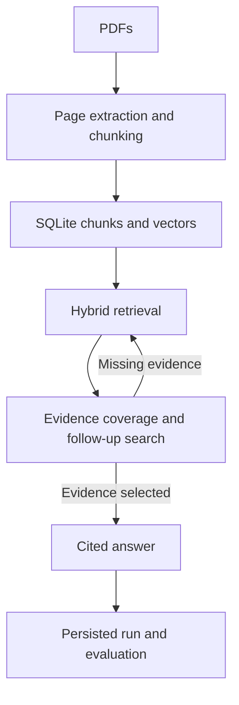

# Technical design and evaluation notes

## Problem and architecture

Academic policies span documents. A general-purpose language model may not know the institution's rules or the relevant version. One broad search can find a registration form while missing the separate eligibility rule. This implementation attaches a trace to retrieval and can search again for parts of a question that lack evidence.

`PDFIngestor` preserves PDF page boundaries, normalizes extraction whitespace and soft line breaks, and applies sentence-aware windows with optional overlap. The sample pages fit in a single chunk per page. This favors traceable page citations. The window limits long passages, although it may separate rules from their qualifications and does not reconstruct complex tables or multi-column reading order. `VectorStore` persists chunk metadata, vectors, the embedding model signature, and run history. Replacing the index is one SQLite transaction. `HybridRetriever` depends on the `Embedder` protocol, while `Agent` accepts independently replaceable search and synthesis components. The terminal entry point constructs them and persists user runs.

## Retrieval maths

The sparse vocabulary is the set of normalized terms in the indexed chunks. For term `t` and a chunk `d`, nonzero term counts use `TF = 1 + ln(count(t,d))`. With `N` chunks and document frequency `df(t)`, `IDF = 1 + ln((N + 1) / (df(t) + 1))`. The sparse vector weights are `TF × IDF`. In the offline profile, the dense vector has 384 entries containing signed hashes of normalized unigrams and bigrams. The Ollama profile uses trained dense document and query embeddings. Dimensionality and the model signature must match during retrieval.

Both branches rank by cosine. Divide the dot product by the product of the vector magnitudes. A zero magnitude gives zero similarity. The combined score is `0.65 × max(0, dense cosine) + 0.35 × sparse cosine`. These weights are implementation choices. They were not tuned in a labelled model comparison. The retrieval trace includes the dense dot product, both magnitudes, both cosine scores, and the combined score. SQLite stores vectors as JSON and this implementation scans them in memory, suitable for the coursework corpus.

## Agent loop and evidence

1. **Observation** records ranked candidates and their source and similarity data.
2. **Reasoning** checks whether each part of the question is covered by the strongest passage. The check uses normalized concept overlap and can inspect two adjacent sentences within a chunk.
3. **Action** issues a focused query for each uncovered part and then synthesizes supported claims or reports specific gaps. Each part is retried once. The terminal records short decisions that can be checked against the PDF excerpts.
4. **Persistence** records the response, selected evidence, and trace for every terminal question in SQLite.

The offline profile extracts a source passage verbatim. The Ollama profile receives the selected passages, returns structured claims with source IDs and exact quotes, and falls back to quotations when the output fails citation or wording checks. These checks cover quoted-source identity, content overlap, numbers and some qualifiers. They can still miss changes in meaning, such as swapped entities, and can reject valid paraphrases.

## Empirical evaluation

The supplied benchmark contains 15 labelled queries over the fictional PDFs. Cases include direct questions, follow-up retrieval, paraphrases, an unsupported question, and a partial answer with a missing fee. Each case contains an expected answer, expected source passages, and required answer phrases when applicable.

| Metric | Automated scoring | Observed offline mean |
|---|---|---:|
| Context Relevance | F1 of selected-evidence precision and labelled-passage recall. Source filename, page, and a reference phrase must match. With no relevant passage expected, no selected evidence scores 1. | 0.933 |
| Groundedness | Share of factual claims with a valid retrieved source, exact quote and sufficient lexical support. Cases with zero factual claims are marked N/A. | 1.000 over 13 scored cases |
| Answer Relevance | Share of expected facts and expected unresolved parts present in the result. For fully unsupported cases, a supported abstention scores 1. | 0.933 |

Q14 asked, “If two classes overlap, who should I notify?” The relevant policy uses “timetable clash”. The offline retriever and lexical coverage check missed the paraphrase and the system abstained. Q01 used two searches and cited two PDFs. Q13 returned the backed eligibility rule and explicitly reported the exact fee as missing. See [the full benchmark output](offline-evaluation.json) for every generated answer. The benchmark is small and uses fictional policies. Phrase matching and extractive output contribute to the high observed groundedness. These figures do not establish performance on real university documents or with the live Ollama profile.

## Five-minute demonstration sequence

1. Show the three input PDFs. Run `python -m rag ingest` and identify the saved vector index.
2. Run `python -m rag ask "Can I repeat a failed module? How do I register?"`. Point out the scores on the first retrieved chunk, the missing eligibility evidence, and the focused query.
3. Show the final answer and both citations. Ask the repeat-module fee question to show a partial answer and a transparent gap.
4. Run `python -m rag evaluate`. Point out all three metrics and explain Q14. Use `python -m rag history --limit 1` to show a persisted run if time permits.

For the final report, explain how your group handled these cases in your own words. A useful live viva exercise is changing the dense/sparse weighting or an evidence threshold, then comparing one trace and the evaluation results. Future work could include retrieving as a separate step for every facet, neural re-ranking, layout-aware extraction and independent human checks of answer entailment.
